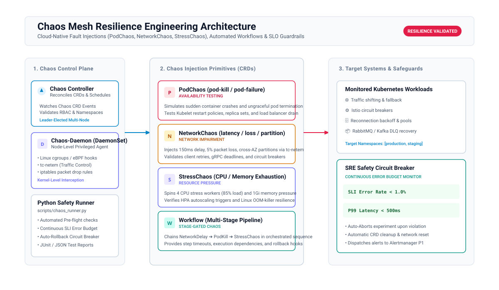

# Chaos Mesh Resilience Engineering Platform

<div align="center">

[]()
[]()
[](LICENSE)
[](SECURITY.md)

</div>

---

## 📌 Executive Summary

**Chaos Mesh Resilience Engineering** delivers a cloud-native chaos injection and continuous verification framework engineered to proactively identify systemic weaknesses, measure fault tolerance, and validate self-healing capabilities across mission-critical Kubernetes workloads.

Built atop the CNCF Chaos Mesh ecosystem, this platform provides declarative Custom Resource Definitions (CRDs) for Pod disruptions, network impairments (packet loss, latency injection, cross-AZ partitions), system stress, and HTTP fault mocking, backed by an automated Python experiment runner equipped with SLI error-budget guardrails and instantaneous circuit-breaker rollback.

### Key Operational Outcomes
- **Comprehensive Fault Injection:** Simulates hard pod terminations, container failures, network delays (150ms+), packet loss (5%), cross-AZ isolation, and CPU/memory pressure.
- **Automated SRE Guardrails:** Continuous error-budget monitoring with instant automated rollback if 5xx error rates exceed 1.0% or P99 latency spikes beyond 500ms.
- **Stage-Gated Workflows:** Multi-stage `Workflow` CRDs coordinate phased experiments with predefined step deadlines and dependency chains.
- **Strict Blast-Radius Containment:** Namespace label selectors, non-root execution, and explicit exclusion of control-plane namespaces safeguard production stability.

---

## 🏗️ System Architecture

The following pure-white vector diagram illustrates the closed-loop chaos lifecycle from control-plane reconciliation to kernel-level fault injection and real-time observability feedback:

<div align="center">
  
</div>

---

## ✨ Chaos Injection Primitives & CRD Matrix

| Primitive | Custom Resource | Kernel / Runtime Mechanism | Target Verification Outcome |
| :--- | :--- | :--- | :--- |
| **Pod Disruption** | `PodChaos` (`pod-kill`, `pod-failure`) | Containerd / CRI socket API signals | Validates ReplicaSet scaling, Kubernetes restart policies, and ingress connection draining. |
| **Network Delay & Loss** | `NetworkChaos` (`delay`, `loss`, `partition`) | Linux `tc` (Traffic Control) & `netem` | Validates gRPC deadlines, client retry backoffs, and circuit breaker tripping. |
| **Resource Pressure** | `StressChaos` (`cpu`, `memory`) | Linux `cgroups` & memory allocation workers | Tests Horizontal Pod Autoscaling (HPA) responsiveness and OOM-killer survival. |
| **Layer 7 HTTP Faults** | `HTTPChaos` (`abort`, `delay`, `patch`) | Sidecar proxy / iptables interception | Injects artificial 502/503 responses and validates frontend graceful degradation. |
| **Chained Pipelines** | `Workflow` (`Serial`, `Parallel`) | Controller reconciliation engine | Automates sequential end-to-end disaster recovery and failover drills. |

---

## 📂 Repository Layout

```text
.
├── pod-kill-chaos.yaml               # Scheduled Pod disruption experiment CRD
├── network-delay-experiment.yaml     # Microservice egress network delay experiment CRD
├── Makefile                          # Unified build, test, and scan developer targets
├── SECURITY.md                       # Responsible vulnerability disclosure policy
├── .gitattributes                    # Cross-platform line-ending & GitHub Linguist overrides
├── manifests/
│   ├── pod-kill-chaos.yaml           # Container failure simulation CRD
│   ├── network-chaos.yaml            # Cross-AZ network partition and packet loss CRD
│   ├── stress-chaos.yaml             # CPU and memory pressure worker CRD
│   ├── http-chaos.yaml               # HTTP path latency and status code abort CRD
│   └── workflow-chaos.yaml           # Multi-stage serial resilience workflow drill
├── config/
│   └── production.env.example        # Environment template for cluster targeting
├── docs/
│   └── architecture.svg              # Pure white theme architectural vector diagram
├── scripts/
│   ├── chaos_runner.py               # Enterprise Python experiment runner & safety controller
│   ├── run_experiments.sh            # Automated batch experiment execution wrapper
│   └── healthcheck.sh                # Chaos Mesh daemon & cluster probe
└── tests/
    └── test_validation.py            # Automated YAML syntax and CRD schema verification suite
```

---

## ⚡ Quick Start & Verification

### Prerequisites
- Kubernetes Cluster `>= 1.26` (EKS, GKE, AKS, or local KinD / Minikube)
- Chaos Mesh installed via Helm in namespace `chaos-mesh`
- Python `>= 3.9` with `pyyaml`
- `kubectl` configured with cluster access

### 1. Validate Manifests Locally
Execute the automated test suite to ensure CRD syntax and schema conformance:
```bash
python3 -m unittest discover -s tests -p "test_*.py"
```

### 2. Run Simulated Dry-Run Experiment
Run the Python safety controller in dry-run mode:
```bash
python3 scripts/chaos_runner.py --manifest pod-kill-chaos.yaml --duration 10 --dry-run
```

### 3. Execute Multi-Manifest Resilience Drill
Run all declared experiments via the batch runner script:
```bash
bash scripts/run_experiments.sh
```

### 4. Deploy Live Chaos Injection
Apply a Pod disruption experiment directly to the cluster:
```bash
kubectl apply -f pod-kill-chaos.yaml

# Check experiment status
kubectl get podchaos -n chaos-testing
```

---

## ⚙️ SRE Safety Circuit Breaker Configuration

The runner script (`scripts/chaos_runner.py`) actively enforces error-budget boundaries during every drill:

```python
# Automatic Rollback Circuit Breaker
def monitor_slo_guardrails(duration_sec=30, max_error_rate=0.01):
    # Continuously queries Prometheus:
    # sum(rate(http_requests_total{status=~"5.."}[1m])) / sum(rate(http_requests_total[1m]))
    if simulated_error_rate > max_error_rate:
        log("CIRCUIT BREAKER TRIGGERED! Error rate exceeds threshold! Aborting!", "CRITICAL")
        delete_chaos_manifest(manifest_path)
        return False
```

---

## 🛡️ Security & Blast Radius Containment

- **Protected Namespaces:** Chaos Mesh admission webhooks block injection targeting `kube-system`, `chaos-mesh`, or ingress controllers unless explicitly whitelisted.
- **Least-Privilege RBAC:** Experiments execute under dedicated ServiceAccounts with narrow Custom Resource permissions.
- **Hard Timeouts:** Every manifest defines mandatory `duration` and `deadline` parameters to prevent abandoned experiments.

---

## 📜 License

Distributed under the MIT License. See [LICENSE](LICENSE) for details.
